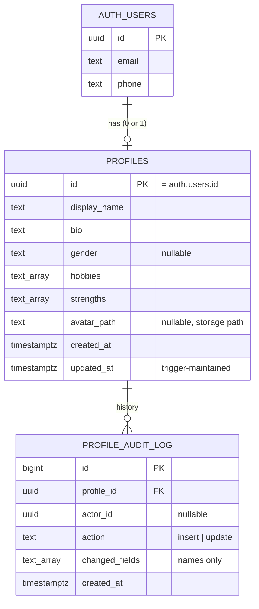

# Database design

> **Status:** Stage 3. Schema applied to the development project (`yydmzbspnwkjqbawhqng`,
> region `ap-northeast-1`) on 2026-10-18 with `supabase db push`. All 35 integration tests
> ([§9](#9-how-this-is-tested)) pass against it, and they leave no test data behind.

All schema lives in versioned SQL files in [`supabase/migrations/`](../supabase/migrations).
The database is the **single source of truth** for profile data: the website and the
Android app never store their own copy.

## 1. Entity overview



- `auth.users` is owned by Supabase Auth (passwords, OTP, OAuth identities). We never write
  to it directly; we only **reference** it.
- `public.profiles.id` **is** the auth user's ID (primary key + foreign key). That makes
  "one profile per user" a database rule, not a convention, and makes deleting a user
  delete their profile (`ON DELETE CASCADE`).

## 2. `profiles` columns and rules

| Column         | Type                            | Rule (enforced by PostgreSQL)                                                | Why                                |
| -------------- | ------------------------------- | ---------------------------------------------------------------------------- | ---------------------------------- |
| `id`           | `uuid` PK, FK → `auth.users.id` | Must be the signed-in user's ID (RLS)                                        | Ties profile to identity           |
| `display_name` | `text` not null                 | 1–60 chars, no leading/trailing spaces                                       | Displayable, no "blank" names      |
| `bio`          | `text` not null, default `''`   | ≤ 500 chars                                                                  | Bounded storage and UI             |
| `gender`       | `text` null                     | One of `female`, `male`, `non_binary`, `other`, `prefer_not_to_say`, or NULL | NULL = not specified               |
| `hobbies`      | `text[]` not null, default `{}` | ≤ 20 items; each 1–40 chars, trimmed; no case-insensitive duplicates         | Clean, bounded lists               |
| `strengths`    | `text[]`                        | Same as hobbies                                                              | Same                               |
| `avatar_path`  | `text` null                     | Must be `<own-user-id>/<safe-name>.(jpg\|png\|webp)`                         | Can't point at someone else's file |
| `created_at`   | `timestamptz`                   | Set on insert; **immutable** (trigger)                                       | Trustworthy history                |
| `updated_at`   | `timestamptz`                   | Set by trigger only when data changes                                        | Clients can't fake it              |

### Why enforce rules in the database when the API validates too?

The website's Supabase **publishable key is public**: anyone can read it from the
JavaScript bundle. A signed-in user could therefore call Supabase's REST layer directly
with their own token and bypass our API. RLS limits them to their **own** row, and the
CHECK constraints make sure even that row can only hold valid data. The API's Zod
validation (Stage 4) gives friendly error messages; the database is the backstop.

### Gender as `text` + CHECK, not a Postgres `ENUM`

Postgres enums can gain values but cannot easily drop or rename them. A CHECK constraint is
changed with one `ALTER TABLE … DROP/ADD CONSTRAINT` in a new migration.

## 3. Where should a field live? (column vs related table vs JSON)

| Shape of the data                                                                      | Store as                       | Example here / future                                                              |
| -------------------------------------------------------------------------------------- | ------------------------------ | ---------------------------------------------------------------------------------- |
| Single value, always present, queried or validated                                     | **Column**                     | `display_name`, `bio`, `gender`                                                    |
| Small list owned by one row, read/written as a whole, not queried across users         | **Array column** (`text[]`)    | `hobbies`, `strengths`                                                             |
| Entities with their own identity, shared across users, or queried ("who likes chess?") | **Related table** + join table | `hobbies` → `hobbies` + `profile_hobbies` if search is needed; `posts`, `comments` |
| Loosely structured settings, rarely queried, schema varies                             | **`jsonb` column**             | future `preferences` (theme, notification toggles)                                 |

Rule of thumb: start with columns; move to a related table when you need to **query
across rows** or attach data to each item; use `jsonb` only for data you don't filter on.

**Future features without rewrites:** `posts`, `comments` and `notifications` become new
tables with `author_id uuid references public.profiles(id)` and their own RLS policies.
Nothing about `profiles` has to change.

## 4. Security layers

```
request with user JWT ─▶ Supabase REST (PostgREST) ─▶ PostgreSQL
                                                      ├─ 1. GRANTs      which tables/columns a role may touch
                                                      ├─ 2. RLS         which ROWS (auth.uid() = id)
                                                      └─ 3. CHECKs      which VALUES
```

### 4.1 Grants (role-level)

| Role                        | `profiles`                                                                                                                                    | `profile_audit_log` |
| --------------------------- | --------------------------------------------------------------------------------------------------------------------------------------------- | ------------------- |
| `anon` (signed out)         | nothing                                                                                                                                       | nothing             |
| `authenticated`             | `SELECT`; `INSERT (id, display_name, bio, gender, hobbies, strengths)`; `UPDATE (display_name, bio, gender, hobbies, strengths, avatar_path)` | `SELECT`            |
| `service_role` (secret key) | everything (bypasses RLS)                                                                                                                     | everything          |

Column-level grants mean `id`, `created_at` and `updated_at` **cannot be written** by a
client at all: Postgres answers `42501 permission denied`.

### 4.2 Row-level security policies

| Table                         | Operation                | Policy                                                   |
| ----------------------------- | ------------------------ | -------------------------------------------------------- |
| `profiles`                    | SELECT / INSERT / UPDATE | `(select auth.uid()) = id`                               |
| `profiles`                    | DELETE                   | none → denied (profiles go away only with the auth user) |
| `profile_audit_log`           | SELECT                   | `(select auth.uid()) = profile_id`                       |
| `profile_audit_log`           | INSERT / UPDATE / DELETE | none → denied (only the trigger writes)                  |
| `storage.objects` (`avatars`) | all                      | first folder of the path = `auth.uid()`                  |

`auth.uid()` returns the `sub` claim of the JWT that Supabase verified. It is wrapped as
`(select auth.uid())` so Postgres evaluates it once per statement instead of once per row.

When RLS hides a row, a SELECT simply returns no rows, and an UPDATE affects 0 rows. That is
why "user A updates user B" looks like "nothing happened" rather than an error.

### 4.3 Authentication vs authorization vs API permissions vs database security

| Concept           | Question                                                       | Where                                      |
| ----------------- | -------------------------------------------------------------- | ------------------------------------------ |
| Authentication    | Who are you?                                                   | Supabase Auth issues a signed JWT          |
| Authorization     | May you do this to this resource?                              | API ownership checks (Stage 4) **and** RLS |
| API permissions   | Which operations exist at all?                                 | Only the routes the API defines            |
| Database security | Even if everything above fails, can this row/value be written? | Grants + RLS + CHECKs                      |

## 5. Triggers

A **trigger** is a function PostgreSQL runs automatically as part of an INSERT/UPDATE/DELETE.
It runs inside the database, for every client: our API, the Supabase dashboard, a script
with the secret key. That is different from:

- an **API call**: code in our server that runs only when a request reaches it;
- a **frontend event handler**: code in the browser that runs only in that one tab.

### 5.1 `profiles_set_updated_at` (BEFORE UPDATE, FOR EACH ROW)

File: [`20261018120100_profiles_updated_at_trigger.sql`](../supabase/migrations/20261018120100_profiles_updated_at_trigger.sql)

```sql
new.created_at := old.created_at;      -- created_at can never change
if new is distinct from old then       -- only if something really changed
  new.updated_at := now();
end if;
return new;                            -- the row that will actually be stored
```

- **BEFORE** so it can modify the row before it is written.
- `now()` is the start time of the current transaction.
- A "save" with no changes leaves `updated_at` alone, so the timestamp means "last real edit".

### 5.2 `profiles_audit` (AFTER INSERT OR UPDATE, FOR EACH ROW)

File: [`20261018120200_profile_audit_log.sql`](../supabase/migrations/20261018120200_profile_audit_log.sql)

- Compares old and new rows as JSON and records the **names** of changed fields, never the
  values, so the log holds no extra personal data.
- `actor_id = auth.uid()`: the end user who made the change. **NULL** means no end user
  was involved (dashboard SQL editor, secret-key script). During a demo this proves changes
  came from the apps, not from manual database edits.
- `SECURITY DEFINER` + `search_path = ''`: runs with the owner's rights so it can write the
  log that users cannot write, and cannot be tricked into using objects a caller created.
- **Transactions:** the trigger runs in the same transaction as the profile change. If
  writing the audit row fails, the profile change is rolled back too: all or nothing.

## 6. Avatar storage

File: [`20261018120300_avatars_storage.sql`](../supabase/migrations/20261018120300_avatars_storage.sql)

- Bucket `avatars`: **private**, 2 MB limit, only `image/jpeg`, `image/png`, `image/webp`.
- Path convention `avatars/<user-id>/<file>`; policies allow access only to your own folder.
- The database stores the **path**, not a URL. On read, the API creates a short-lived
  **signed URL**. That way, revoking access or deleting a file never leaves a permanent
  public link behind.

## 7. Indexes

| Index                                                                 | Serves                                             |
| --------------------------------------------------------------------- | -------------------------------------------------- |
| `profiles_pkey (id)`                                                  | Every profile lookup (always by the user's own ID) |
| `profile_audit_log_pkey (id)`                                         | Row identity                                       |
| `profile_audit_log_profile_created_idx (profile_id, created_at desc)` | "My recent changes" and the RLS filter             |

No other indexes yet: we never search profiles by other fields. Add an index when a real
query needs it (check with `EXPLAIN ANALYZE`), not in advance.

## 8. Migrations: workflow, rollback and recovery

### Applying changes

```bash
npx supabase migration new add_preferences
```

```bash
npx supabase db push --linked --dry-run
```

```bash
npx supabase db push --linked
```

```bash
npx supabase migration list --linked
```

Rules:

1. **Never edit a migration that has been applied anywhere.** Write a new one.
2. Apply to **dev first**, run the integration tests, then production.
3. Each migration should be safe to apply on a database that has real data.

### Rolling back

Supabase migrations are forward-only: there is no automatic "down" step. To undo a change,
write a **new** migration that reverses it, e.g. `alter table … drop column …`. Before any
destructive change in production:

- take a backup first. The free plan has no downloadable backups (see `docs/deployment.md`),
  so use `npx supabase db dump --linked -f backup.sql` for the schema and
  `npx supabase db dump --linked --data-only -f data.sql` for the data;
- prefer "expand, then contract": add the new column → deploy code that uses it → remove the
  old column in a later migration.

### Recovering a broken development database

Development data is disposable. Recreate the project or drop the `public` objects, then run
`npx supabase db push --linked` to replay all migrations from the start. That migrations can
rebuild the schema from nothing is itself a test that they're complete.

## 9. How this is tested

[`apps/api/test/integration/database.test.ts`](../apps/api/test/integration/database.test.ts)
runs against the **development** project through the same REST layer the apps use. It
creates throwaway users and deletes them at the end, and covers:

- creating your own profile, and the database setting both timestamps;
- RLS: no creating, reading or updating someone else's profile; anonymous gets nothing;
- column grants: `id`, `created_at`, `updated_at` cannot be written;
- every CHECK constraint, with a bad value for each;
- the `updated_at` trigger: bumps on change, not on no-op, and fires for privileged edits too;
- the audit trigger: field names only, actor recorded, NULL actor for privileged edits,
  no direct writes, no reading other users' history;
- storage: own-folder upload and signed URL, foreign folder denied, private bucket, images only;
- deleting the auth user cascades to the profile and its audit rows.

```bash
npm run test:integration
```

Requires `apps/api/.env.test` (template: `apps/api/.env.test.example`) with the
development project's URL, publishable key and secret key.

### Inspecting the data yourself (authorized developers)

Supabase dashboard → project → **Table Editor** → `profiles` / `profile_audit_log`, or
**SQL Editor**, for example:

```sql
select id, display_name, updated_at from public.profiles order by updated_at desc limit 20;
select * from public.profile_audit_log order by created_at desc limit 20;
```

The dashboard uses a privileged role, so it sees every row. Edits made there show up in
the audit log with `actor_id = NULL`.
